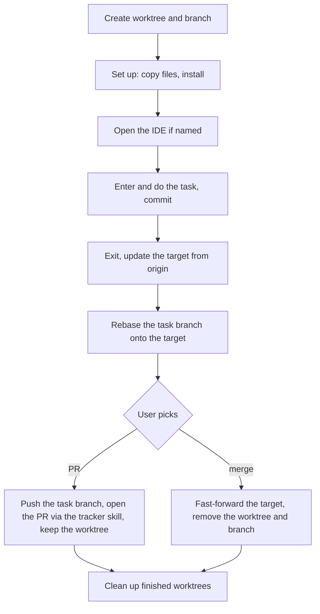

# Isolation

`/git isolation <task> [ide]` does the task in a separate worktree, branched from the current branch, and lands it back on that branch through a PR or a merge.

## Names

| Item          | Value                                                                                                     |
|---------------|-----------------------------------------------------------------------------------------------------------|
| `<task>`      | a short kebab-case slug of the task; ask when the request gives no clear one                              |
| worktree path | `../.tmp/<repo>/<task>` from the main checkout root; `<repo>` is the main checkout's folder name          |
| branch        | the project's branch naming applied to `<task>`, else `<task>`                                            |
| target        | the branch current at the start; recorded as the task branch's upstream, so it survives across sessions; pushes never pass `-u` |

## Start

1. `git worktree add --track -b <branch> <path> <target>` — `--track` makes the target the branch's upstream.
2. Copy gitignored files from the main checkout: those matching `.worktreeinclude` patterns when the repo has one, else `.env*` files outside dependency folders.
3. Install dependencies with the project's install command; else, by the lockfile, in frozen mode: `npm ci`, `pnpm install --frozen-lockfile`, `yarn install --immutable` (Yarn 1: `--frozen-lockfile`), `bun install --frozen-lockfile`. A failed install: report and ask.
4. IDE named: open the worktree with the IDE's command-line launcher — for JetBrains IDEs, the Toolbox shell script such as `webstorm`. No launcher found: give the user the path.
5. Enter the worktree: Claude Code's `EnterWorktree` tool with `path` — the user approves once, since the path is outside the project. Without that tool, keep the main session where it is and address the worktree by absolute paths and `git -C <path>`; a `cd` outside the project does not persist between commands.

Work and commit inside the worktree with the [Commit](../SKILL.md#commit) rules.

## Finish

Once the task is done, ask: PR or merge — unless the request already said. The target is `git rev-parse --abbrev-ref <branch>@{upstream}`.

1. Commit everything in the worktree.
2. Leave the worktree: `ExitWorktree` when you entered with `EnterWorktree` — while inside, Claude Code blocks git commands aimed at the main checkout.
3. Update the target when it tracks a remote branch: `git pull --ff-only` in the main checkout if the target is checked out there, else `git fetch <remote> <remote branch>:<target>`. Diverged: stop and report. A target without a remote branch stays as it is: a merge works locally, a PR needs the target pushed first — ask.
4. `git -C <path> rebase <target>`. A conflict: `git -C <path> rebase --abort`, report the files, stop.
5. Then:
   - **PR**: `git -C <path> push origin <branch>`, open the PR against `<target>` through the tracker skill. Keep the worktree and branch: [Clean up](#clean-up) removes them once the PR is merged.
   - **merge**: in the main checkout, `git merge --ff-only <branch>` when it is on `<target>`, else `git fetch . <branch>:<target>`; then `git worktree remove <path>` and `git branch -d <branch>`.

## Clean up

At the end of every `isolation` run, and for `isolation cleanup [task]`, check each worktree under `../.tmp/<repo>/` from `git worktree list`:

- Its branch has a PR the tracker shows merged, the PR head commit equals the local branch tip, and the worktree is clean: `git worktree remove <path>`, then `git branch -D <branch>` — a squash merge leaves the branch unmerged for git.
- `isolation cleanup` names a task without a merged PR: ask before removing; uncommitted changes need approval to discard, per Safety.
- Anything else stays; list it in the report.
