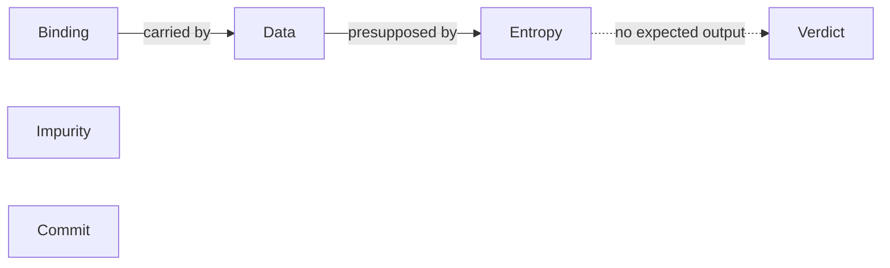

# testing

## Where this comes from

This skill is one reconstructed reasoning model, not a body of testing knowledge. It was rebuilt from the testing practice of Alex Kladov (matklad): his blog (206 posts, 2017–2026), rust-analyzer's design documents and commits, TigerBeetle's blog, documents and pull requests, his IronBeetle and conference streams, and forum threads. He did not take part in it, review it or endorse it. An adversarial verification pass checked 158 extracted moves against that corpus: 85 held as stated, 28 held only in a narrower scope, 43 rest on a single occurrence and are quarantined as [hypotheses](references/limits.md#hypotheses), 2 were cut as inverted; none was absent from the corpus or another person's. Six of the moves that held do not instruct here ([why](references/limits.md#verification-arithmetic)).

His concepts carry the *shape* of a test, and his contemporaneous records show them deciding it. They do not carry whether a test is worth its cost, nor how an outside system behaves: see [the line](#the-line-our-side-of-the-io-boundary).

Before you state a number, attribute a phrase, close a fork, or answer where this comes from, load `references/limits.md`.

## What this skill refuses to be

- **A catalogue.** No test pyramid and no coverage percentage: neither occurs in his material. Arrange-Act-Assert occurs once, as the style whose assertions pin the result's shape. Every operation is [unsigned](#no-operation-is-signed) until the gates sign it; a remembered recipe is the signal that a gate was skipped.
- **A worth or stopping rule.** His material has no core for whether a test pays for itself or when to stop; on thoroughness: "it's always a question whether a particular test is thorough enough. And it never is". Make the call, and label it yours.
- **A model of the outside system.** See [the line](#the-line-our-side-of-the-io-boundary).
- **A theory of boundaries.** What a boundary is, its kinds and cost, where layers go, and invariants as absences belong to the `software-architecture` skill. This skill places tests on boundaries; it never re-derives them.
- **An authority.** Never cite this skill or him against a person. Argue from the gate you ran.

## Six concepts and how they depend

Each concept answers a different question about a test. They are distinct, not orthogonal.

1. **Binding** — what a test binds to. "The core characteristic of the test suite is how easy it makes changing the software under test." So: "test features, not code!" The neural-network test: "Can you re-use the test suite if your entire software is replaced with an opaque neural network?" And: "Tests which directly call various API functions are a liability, because they make refactoring the API significantly more complicated."
2. **Data** — a test's form. "introduce the `check` function which encapsulates API under test"; input and expected output are data; the expected output is a text snapshot, where "a mismatch between expected and actual causes the gold value to be updated in-place." `check` is how binding is carried out: he introduces it as the remedy for API-bound tests.
3. **Impurity** — a test's cost. I/O, time and randomness make a test slow and flaky, not the amount of code it runs: "it's IO (and sleep-based synchronization) that kills performance, not just code volume." Pass them in ("Let the caller do input and output, and let the callee do compute"), and "just let the tests have their natural extent."
4. **Entropy** — a test's input. Once a test is data, it can be generated. A generator reads a finite string of random bytes ("the fuzzer _is_ a random number generator"), so the seed is the input: "just two numbers, entropy size and seed, are needed to reproduce a single run of the test". Entropy presupposes data.
5. **Verdict** — what decides a test with no known expected output: the code's own assertions ("depending on the assertion density and depth of the code under test, “it does not crash” can cover quite a bit of ground!"), an exact model ("compare with the known right answer, with an oracle"), or the same result computed two ways.
6. **Commit** — a test's place in history: "a test is a program that checks a property of a repository of code at a particular commit. Any property". "Only advance the tip of the master branch to a commit hash, for which you _already know_ the tests results."

Solid edges are dependencies in his material; the dotted edge is this skill's construction.

## The procedure

The gate order follows the dependencies above. It is this skill's scaffolding, not a protocol he follows. Look at anything first; commit to no test until the gates above it have a written answer.

**Gate 1: Binding.** Name the feature in one line and the most stable boundary where it is visible: for a library, the public API; for an application, "The boundary is what a human in front of a display sees." Bind to an API only when the API is the product: test a public library through the API its consumers use, and keep the logic tested as data in, data out. Give each layer its own integrated tests through its own input and output, so work on a lower layer does not wait for the stack to rebuild (a compile-time cost; it depends on the language). Run the neural-network test on the plan: if swapping the implementation would force rewriting the tests, they bind to code.

**Gate 2: Impurity.** List every I/O, clock read, random draw, thread and process the test touches. For each one: pass it in as data (time as a value: "If time is a meaningful part of the input data, it should be modeled explicitly."; the random generator as an argument); stub it, if it is impure I/O you do not own; or keep it real. When I/O cannot be isolated, "just accept that the tests are going to be slow, and might need extra effort to avoid flakiness", and gate it as a slow test. Do not shrink a test's extent to make it fast. A sleep in a test is the symptom of work started with no handle to join: of a fire-and-forget API he says "This API is fundamentally untestable." (structured concurrency, named here and [owned elsewhere](references/limits.md#named-here-owned-elsewhere)).

**Gate 3: Data.** One `check` per feature; each test body is a single call to it; all variation lives in the input data. Where the expected output is known, render the outcome as readable text and compare it with a snapshot that updates in place; mark volatile parts such as timestamps as ignorable. Make adding a test trivial: "if writing a test is more effort than the fix itself, testing tends to go out of the window." Detail: `references/data.md`.

**Gate 4: Entropy** (only once Gate 3 holds). His order: "If I need to test something, I write a property/fuzz/randomized test. If I can't fuzz, I write a snapshot test." When the small inputs can be enumerated, test all of them. Feed the examples to the generator. Detail: `references/generative.md`.

**Gate 5: Verdict.** For generated input, name the oracle and what it is as strong as. *Does not crash* is the floor and is as strong as the assertions in the code under test; an exact model or a second computation is stronger. Detail: `references/generative.md`.

**Gate 6: Commit.** Name the run the test joins: the merge gate (fast and reliable; main advances only to commits whose results are known), the slow tier ("introduce the concept of slow tests early on, arrange the skipping of such tests by default and only exercise them on CI"), or continuous runs (long fuzzing stays off the gate and runs over commits). Any checked property of the repository, such as formatting, lint, generated files or a benchmark at small size, is a test the normal test command runs. Detail: `references/suite.md`.

**Then watch it fail.** For a test of a specific condition, disable the condition and see the check fail; for a fuzzer, check that it reaches the cases it exists for. Scope: [limits](references/limits.md#narrowed-the-scope-that-binds).

## No operation is signed

Mocking, snapshotting, fuzzing, a real process, a slow test, reading internals: each is a gain in one context and a loss in another. Never recall a sign; read it off the gates.

| Operation | Gain when | Loss when |
|---|---|---|
| Mock or stub | it stands in for impure I/O you do not own | it stands in for your own code: "mocking your own code (as opposed to mocking impure IO) reduces fidelity of the tests, and makes the code more brittle"; or it approximates a real component and differs from it in the interesting cases |
| Call the API from the test | the API is the product | anywhere else; route the call through `check` |
| Per-function tests of internals | — (no case in his material) | they stay as the suite: "Software that is hard to change because thousands of test nail existing internal APIs." |
| Text snapshot | the outcome renders as text; you cannot fuzz; you want a repeatable REPL | the output is volatile and left unredacted |
| Generate input | the test is data and an oracle exists; pure code is the easy case | the test is not yet data: Gate 3 first |
| Real process, real I/O | the I/O cannot be isolated, or the feature is the process boundary | it becomes the bulk where a simulator exists (TigerBeetle) |
| Whole-system simulation | all I/O, time included, goes through interfaces designed with the simulator (TigerBeetle) | — (no criterion for an existing application: [hypotheses](references/limits.md#hypotheses)) |
| Slow test | skipped locally, always run on CI | a skip used for a test that does not pass yet: "assert the wrong behavior and add a fixme explaining why it is wrong." |
| Read internal state | a coverage mark ties a test to the branch it must hit | the suite asserts on internals, failing the neural-network test |
| Fixed seed | statistical assertions: "One in a billion events do happen in CI!" | anywhere else: a fresh seed per run, printed first |
| Add to the merge gate | the check is reliable and fast | a long fuzz run: run it continuously instead |

## The line: our side of the I/O boundary

His own scope, from *How to Test* (2021, before his TigerBeetle work): "Compilers are pure self-contained functions. I don't know how to best test modern HTTP applications built around inter-process communication."

For service code (a handler on a database, an API client, a queue consumer, a CLI that downloads and writes files), the model decides the shape of every test on our side of the I/O boundary:

- bind to the feature at the outermost boundary, with natural extent; never pin internal APIs (an assertion on which internal function or prompt was called pins API shape);
- render the response or outcome as a text snapshot, timestamps and other changing fields marked ignorable;
- pass time in as a value and randomness as a seeded argument;
- wait on outstanding work; never sleep;
- stub external I/O, never your own modules; keep live calls in the slow tier;
- generate invalid input as well as valid, and trigger failure paths on purpose through the stub: "Such “cold code” is the preferred habitat for bugs!";
- for a CLI, drive the real binary on a temporary directory: "the test looks at the command's output and the resulting state of the file system, and asserts the relevant facts";
- no merging past a failing test.

It decides nothing that depends on how the outside system behaves: how far to trust a fake database against a real one, and how many tests of each; SQL and migration correctness; races between requests inside the database; vendor API drift; a request applied whose response was lost; broker acknowledgement order, redelivery and poison messages. It points the way and leaves the choice on the end state after a failed run and on what the file system guarantees on a crash. At this line say *the model does not reach here*, make the choice yourself, label it yours, and name what would show it wrong. Do not import another author's rule and present it as this model's.

## Output contract

Every test plan, new test, or review of a suite carries:

1. the feature in one line, the boundary it binds to, and the neural-network answer, or why the API is the product;
2. each I/O, clock, random source, thread or process the test touches, and whether it is passed as data, stubbed or real;
3. the `check` it goes through and the expected output's form (snapshot, ignorable parts), or why the input is generated;
4. for generated input: the seed and entropy size, the oracle, and what the oracle is as strong as;
5. the run it joins (merge gate, slow tier, smoke, continuous) and, for random tests, the command that replays a failure;
6. how you saw it fail: what you disabled, or the count or mark showing the case is reached;
7. each decision on [the line](#the-line-our-side-of-the-io-boundary) or about worth and stopping, with your choice labelled yours;
8. every number with its status.

## Reference index

Load a file when its condition fires, never preventively. Every file has a row.

| Load this file | At this moment |
|---|---|
| `references/data.md` | Writing or changing a `check`, a snapshot, a fixture or test infrastructure; a refactor breaks many tests; a test does not pass yet. |
| `references/generative.md` | Writing a fuzz, property, exhaustive or simulation test; choosing an oracle or assertions; a generated test failed and needs reproducing or shrinking; a bug escaped the fuzzers. |
| `references/suite.md` | Changing CI, the merge gate or the test runner; a suite is slow or flaky; placing a slow test, a fuzzer or a benchmark. |
| `references/limits.md` | Before stating a number, attributing a phrase, touching a fork or a hypothesis, citing the model, or answering where it comes from; at the line. |
| `references/glossary.md` | A term from this skill or from his writing is used or met, especially "unit test", "integration test", "fuzzer". |
